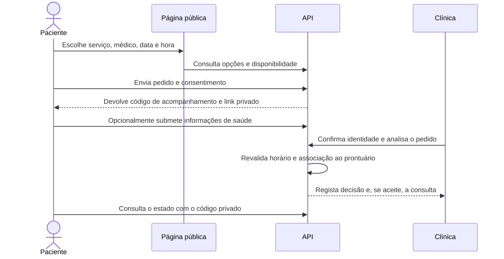
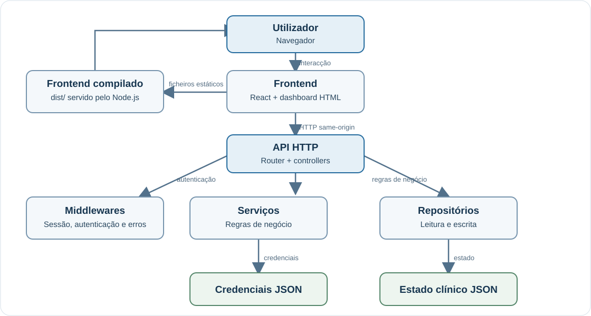

# MVida MAXI VIDA
## Sistema de Gestão Clínica — Relatório técnico-académico

## Índice

1. [Introdução](#1-introdução)
2. [Problema, objectivos e âmbito](#2-problema-objectivos-e-âmbito)
3. [Metodologia de desenvolvimento](#3-metodologia-de-desenvolvimento)
4. [Descrição funcional](#4-descrição-funcional)
5. [Arquitectura do sistema](#5-arquitectura-do-sistema)
6. [Padrões e decisões de projecto](#6-padrões-e-decisões-de-projecto)
7. [Tecnologias e ferramentas](#7-tecnologias-e-ferramentas)
8. [Modelo de dados e persistência](#8-modelo-de-dados-e-persistência)
9. [Segurança, privacidade e limitações](#9-segurança-privacidade-e-limitações)
10. [Instalação e execução](#10-instalação-e-execução)
11. [Testes e critérios de validação](#11-testes-e-critérios-de-validação)
12. [Implantação](#12-implantação)
13. [Trabalho futuro](#13-trabalho-futuro)
14. [Conclusão](#14-conclusão)
15. [Referências](#15-referências)
16. [Glossário](#16-glossário)

---

## 1. Introdução

Uma clínica precisa de coordenar informação administrativa, operacional e clínica sem perder de vista quem pode consultar ou alterar cada tipo de dado. Quando esses processos ficam dispersos por ferramentas ou registos independentes, torna-se mais difícil acompanhar consultas, cobranças e o histórico de cada paciente.

O MVida MAXI VIDA foi desenvolvido para centralizar esses fluxos numa aplicação web. A aplicação contempla perfis distintos para a equipa e para pacientes, bem como um percurso de marcação pública que não confunde um pedido ainda não confirmado com uma consulta efectivamente marcada.

Este documento tem finalidade simultaneamente descritiva e técnica: explica como a solução está organizada, quais as decisões arquitecturais identificáveis no código e que cuidados ainda são necessários antes de utilizar dados reais de saúde.

### 1.1 Organização do relatório

O relatório começa pela definição do problema e dos objectivos. Em seguida descreve as funções, a arquitectura e os padrões utilizados. As secções finais apresentam instalação, testes, implantação, limitações, trabalho futuro e conclusão.

## 2. Problema, objectivos e âmbito

### 2.1 Problema

O problema abordado é a necessidade de apoiar, num único sistema, a gestão de pacientes e profissionais, a marcação e realização de consultas, a cobrança dos serviços e a consulta de informação por diferentes perfis. O sistema deve ainda separar um pedido público de consulta da confirmação clínica e evitar que um número de telefone, por si só, associe uma pessoa a um prontuário existente.

### 2.2 Objectivo geral

Desenvolver uma aplicação web que centralize fluxos administrativos e de acompanhamento do paciente, validando no servidor as operações sensíveis e limitando os dados disponibilizados a cada perfil.

### 2.3 Objectivos específicos

- Organizar pacientes, profissionais, especialidades, serviços e respectivos preços.
- Consultar a disponibilidade dos médicos e gerir consultas dentro dos seus horários.
- Permitir ao profissional responsável registar a informação clínica da consulta e concluí-la.
- Associar cobranças às consultas concluídas e disponibilizar recibos e relatórios.
- Aplicar permissões por perfil tanto na API como na projecção de dados.
- Disponibilizar uma área autenticada do paciente para novas consultas, histórico, dados declarados e recibos.
- Permitir pedidos públicos sem associar automaticamente o requerente a um paciente registado.
- Manter documentação, testes automatizados e instruções de execução e implantação.

### 2.4 Âmbito e exclusões

O sistema cobre a gestão operacional e os fluxos descritos neste documento. O pedido público fica pendente de análise pela Recepção ou Administração; não equivale a uma consulta confirmada. A clínica confirma a identidade e decide se cria um registo de paciente ou associa o pedido a um registo existente.

O formulário público recolhe nome, número de WhatsApp, serviço e horário pretendidos, mas **não verifica automaticamente o número por WhatsApp e não envia mensagens**. Depois de submeter, o requerente recebe no ecrã um código privado para acompanhar o estado e um link único para informações de saúde opcionais. A criação e associação de um registo clínico só ocorre após análise da clínica.

O projecto **não** é um sistema de diagnóstico, não substitui o juízo clínico e não dispõe actualmente de base de dados relacional, encriptação de dados em repouso nem cópias de segurança externas já configuradas.

## 3. Metodologia de desenvolvimento

A implementação está organizada por funcionalidades e responsabilidades, com alterações incrementais acompanhadas por testes automatizados. Os fluxos são verificados na fronteira da API, além das validações de interface: o cliente pode orientar o utilizador, mas a decisão final sobre permissões, disponibilidade, preço e estado é do servidor.

O repositório contém testes escritos com o executor nativo `node:test`. Há testes de integração da API, regras de acesso, marcação pública e validação da interface legada. O processo de entrega inclui testes, compilação de produção e verificação do serviço após a implantação.

Não há neste repositório evidência de um processo académico formal de recolha de requisitos com participantes, estudo clínico, ensaio de usabilidade ou validação institucional. Por isso, as afirmações deste relatório limitam-se às funções implementadas e aos testes presentes.

## 4. Descrição funcional

### 4.1 Módulos principais

| Módulo | Responsabilidade |
|---|---|
| Início | Apresentar indicadores e próximas consultas de acordo com o perfil. |
| Consultas | Consultar agenda, criar e actualizar consultas dentro das permissões. |
| Pacientes | Manter os registos administrativos de pacientes. |
| Serviços | Manter o catálogo de serviços, especialidades e preços. |
| Pagamentos | Acompanhar cobranças, registar pagamentos e consultar recibos. |
| Relatórios | Consultar e descarregar documentos de relatório disponíveis. |
| Funcionários e utilizadores | Manter profissionais, contas e acessos. |
| Auditoria | Consultar registos de operações relevantes. |
| Portal do paciente | Marcar consultas, consultar histórico, recibos e dados declarados. |
| Marcação pública | Consultar serviços e horários, enviar pedido e acompanhar o seu estado. |
| Pedidos online | Analisar os pedidos públicos e confirmar a identidade antes da associação clínica. |

### 4.2 Percursos do paciente

**Paciente com acesso criado pela clínica:** inicia sessão no sistema, entra no Portal, consulta os seus dados e históricos e pode marcar uma consulta directamente na agenda, se houver médico, serviço e horário elegíveis.

**Pessoa sem acesso ao Portal:** utiliza a página pública para escolher serviço, médico, data e horário e envia um pedido. O pedido reserva esse horário durante até 24 horas e fica pendente; ainda não é uma consulta marcada. A Recepção ou a Administração confirma a identidade e analisa o pedido. A aceitação cria a consulta depois de validar novamente o horário e os conflitos; o número WhatsApp não é verificado automaticamente nem usado para localizar um prontuário.

Após o envio, a pessoa recebe no próprio ecrã um código aleatório para acompanhar o estado e um link separado para enviar, opcionalmente, informações prévias de saúde. Estes valores **não são enviados por WhatsApp ou e-mail**; devem ser guardados pelo utilizador. O pedido e o link de informações de saúde expiram após 24 horas. A informação clínica submetida fica separada do prontuário até a clínica confirmar a identidade e efectuar a associação.

#### Como o paciente entra no Portal

O Portal autenticado é diferente da marcação pública. Para receber acesso:

1. A Recepção ou o Administrador regista o paciente em **Pacientes**.
2. Na lista de pacientes, escolhe **Criar acesso do paciente**, associa um e-mail ao registo correcto e cria a conta.
3. O sistema mostra uma palavra-passe temporária uma única vez. A clínica entrega o e-mail e essa palavra-passe ao paciente por um canal privado.
4. O paciente abre o endereço do sistema, inicia sessão com essas credenciais e define uma palavra-passe própria no primeiro acesso.
5. Depois da autenticação, o perfil **Paciente** vê apenas os dados associados ao seu próprio número de processo e pode usar o **Portal do paciente**.

O próprio paciente não cria uma conta nem recupera o acesso por auto-registo. Se ainda não recebeu credenciais, deve pedir à Recepção ou ao Administrador que crie o acesso. Uma pessoa sem conta pode usar a página pública para **pedir** uma marcação, mas deve aguardar a análise da clínica; o formulário público não inicia sessão nem confirma automaticamente uma consulta. A verificação automática por WhatsApp não está implementada.



### 4.3 Percurso da consulta e do pagamento

O servidor valida o profissional, serviço, preço, horário de trabalho, data e hora futuras, disponibilidade e ausência de conflito. O horário usa o fuso `Africa/Maputo`. O preço vem do serviço activo seleccionado. O médico responsável pode iniciar e concluir a consulta; a conclusão exige uma nota clínica válida e gera uma cobrança pendente ligada à consulta.

A Recepção ou a Administração regista o pagamento integral: Dinheiro não exige referência adicional; Cartão exige os últimos quatro dígitos; Transferência exige o número do comprovativo; Pagamento móvel exige um número M-Pesa válido. O recibo inclui um número único. Uma cobrança paga não volta a pendente; anulação administrativa e estorno representam operações distintas e mantêm o histórico. Relatórios e recibos podem ser gerados em PDF pela interface.

### 4.4 Perfis e permissões

As permissões são verificadas no servidor. A interface adapta a navegação ao perfil, mas ocultar um botão não substitui a autorização da API.

| Perfil | Acesso funcional |
|---|---|
| Administrador | Gere o sistema, contas, equipa, pacientes, consultas, serviços, preços, pagamentos, relatórios e auditoria. |
| Recepção | Gere informação administrativa dos pacientes, pedidos públicos, consultas, serviços e operações de pagamento permitidas. Não recebe dados clínicos restritos nem pode concluir consultas ou anular pagamentos. |
| Médico | Consulta as consultas que lhe estão atribuídas, os dados necessários dos pacientes associados e actualiza o estado e a nota clínica das próprias consultas. |
| Financeiro | Consulta informação operacional necessária a pagamentos, sem notas clínicas; não pode registar ou alterar pagamentos nem aceder a relatórios restritos. |
| Paciente | Consulta apenas o seu próprio perfil, consultas, pagamentos e informações de saúde declaradas; pode marcar directamente no Portal autenticado. |

O acesso do paciente é criado pela clínica e associado a um número de processo. O perfil antigo `Cliente` continua aceite como compatibilidade com contas existentes e é apresentado como **Paciente**. O sistema gera números de processo no servidor e corrige identificadores legados vazios, inválidos ou repetidos durante o carregamento.

## 5. Arquitectura do sistema

### 5.1 Visão geral

A aplicação é um **monólito modular**: frontend, API, regras de negócio e persistência são implantados como um serviço Node.js. O backend está organizado em camadas. Esta descrição não implica microserviços nem uma separação de deploy entre frontend e API.



### 5.2 Frontend

O frontend está em `frontend/`. O ponto de entrada React está em `frontend/src/`; o componente `LegacyDashboard` obtém o dashboard HTML, extrai o markup, estilos e scripts e monta-os na aplicação React. Assim, **React funciona como estrutura de montagem e integração**, enquanto a interface de gestão continua parcialmente implementada como HTML, CSS e JavaScript legado em `frontend/public/dashboard.html`.

O ficheiro `frontend/public/mvida-api-bridge.js` liga a interface às rotas da API e mantém a compatibilidade das operações de estado. A página pública de pedidos está em `frontend/public/marcar-consulta.html`; a página de login inclui a ligação para ela. O Vite copia os recursos públicos e compila a aplicação para `dist/`, que é servido pelo backend.

Esta arquitectura permite conservar fluxos já existentes durante a migração gradual. Não significa que cada ecrã já seja um componente React independente.

### 5.3 Backend

O backend usa módulos ES do Node.js e a API HTTP nativa. A composição em `backend/src/app.js` instancia as dependências e liga rotas, controllers, serviços e repositórios.

| Camada | Localização | Papel |
|---|---|---|
| Entrada e composição | `backend/src/server.js`, `backend/src/app.js` | Inicializar servidor e dependências. |
| Rotas e controllers | `backend/src/routes/`, `backend/src/controllers/` | Interpretar método, caminho e entrada HTTP; produzir respostas. |
| Serviços | `backend/src/services/` | Aplicar regras de negócio, permissões e validações. |
| Repositórios | `backend/src/repositories/` | Ler e guardar estado e credenciais. |
| Domínio | `backend/src/domain/` | Definir colecções, validação e integridade básica do estado. |
| Infraestrutura transversal | `backend/src/middlewares/`, `backend/src/utils/`, `backend/src/config/` | Autenticação, erros, leitura de JSON, ficheiros estáticos e configuração. |

### 5.4 Arquitectura de pedidos HTTP

1. O servidor recebe o pedido.
2. Os caminhos `/api/` são encaminhados para o router; os restantes pedidos são servidos como ficheiros do frontend compilado.
3. O controller valida o tipo de operação e lê a entrada.
4. O serviço de aplicação verifica a sessão e aplica as regras do domínio.
5. O repositório carrega ou persiste o estado.
6. A API devolve uma resposta JSON com o resultado ou um erro HTTP.

A API segue convenções HTTP e é **orientada a recursos**, mas não se declara implementação formal de todas as restrições REST.

### 5.5 Principais rotas da API

Todas as rotas são servidas pela mesma origem. As rotas do Portal e da equipa requerem sessão válida, excepto quando indicado.

| Método e caminho | Acesso | Finalidade |
|---|---|---|
| `GET /api/health` | Público | Verificar a disponibilidade do servidor. |
| `GET /api/setup/status` | Público | Verificar se já existe configuração inicial. |
| `POST /api/setup` | Público, só na configuração inicial | Criar a conta inicial de Administrador. |
| `POST /api/auth/login` | Público | Iniciar sessão. |
| `GET /api/auth/session` | Sessão | Consultar a sessão actual. |
| `POST /api/auth/logout` | Sessão | Terminar sessão. |
| `POST /api/auth/change-password` | Sessão | Alterar palavra-passe. |
| `GET /api/state` | Sessão | Obter o estado permitido ao perfil autenticado. |
| `POST /api/state` | Administrador | Migrar dados somente antes de existir estado persistido. |
| `PUT /api/state` | Sessão autorizada | Validar e guardar alterações permitidas. |
| `PATCH /api/appointments/complete` | Médico responsável | Concluir uma consulta com a nota clínica exigida. |
| `POST /api/users/password/reset` | Administrador | Repor a palavra-passe de uma conta. |
| `POST /api/users/patient-invite` | Clínica autorizada | Criar acesso associado a um registo de paciente. |
| `GET /api/patient/portal` | Paciente/Cliente | Obter dados, consultas, pagamentos e disponibilidade do Portal. |
| `POST /api/patient/appointments` | Paciente/Cliente | Marcar uma consulta validada pelo servidor. |
| `POST /api/patient/health-profile` | Paciente/Cliente | Actualizar informações de saúde declaradas pelo próprio. |
| `GET /api/public/booking/options` | Público | Consultar médicos e serviços disponíveis para marcação. |
| `GET /api/public/booking/availability` | Público | Consultar horários livres, até 90 dias. |
| `POST /api/public/booking` | Público | Criar um pedido pendente, sujeito à análise da clínica, e devolver códigos privados. |
| `POST /api/public/booking/status` | Código privado | Consultar estado sem expor dados clínicos. |
| `POST /api/public/booking/health-info` | Link privado | Submeter informação prévia de saúde. |
| `GET /api/booking-requests` | Recepção/Administrador | Consultar a fila de pedidos públicos. |
| `PATCH /api/booking-requests/:id` | Recepção/Administrador | Aceitar ou recusar um pedido após análise. |
| `POST /api/booking-requests/:id/health-link` | Recepção/Administrador | Emitir um link privado para informações de saúde. |

As respostas de erro são convertidas para JSON. O servidor aplica validação e autorização independentemente das verificações efectuadas na interface.

## 6. Padrões e decisões de projecto

### 6.1 Princípios adoptados no MVida

| Princípio | Onde e como foi aplicado | Porquê |
|---|---|---|
| Separação de responsabilidades | O backend separa router/controllers, serviços, domínio e repositórios; no frontend, `LegacyDashboard` monta a interface e o bridge trata a comunicação com a API. | Tornar cada parte mais fácil de compreender, testar e alterar sem concentrar todo o comportamento num único ficheiro. |
| Segurança no servidor e privilégio mínimo | `StateAccessService` valida o perfil, os campos permitidos e as operações. `roleView` projecta dados diferentes para Recepção, Médico, Financeiro e Paciente. | A interface pode ser manipulada; ocultar um botão não protege dados ou operações. A API deve ser a autoridade final. |
| Minimização e separação de dados | O formulário público não pede dados clínicos. O código de acompanhamento e o link de saúde são tokens separados; as informações de saúde do pedido ficam fora do prontuário até a clínica confirmar a identidade. | Reduzir recolha desnecessária e evitar que um número de telefone isolado associe alguém ao prontuário errado. |
| Integridade e validação no servidor | Datas, horários, agenda, especialidade, preço, transições de consulta, cobranças e associações são revalidados nos serviços do backend. | Evitar depender de valores enviados ou validações exclusivamente visuais no navegador. |
| Auditabilidade e preservação do histórico | Operações relevantes criam entradas de auditoria; consultas e cobranças ligadas ao histórico não são simplesmente removidas, e serviços usados podem ser desactivados em vez de eliminados. | A clínica precisa de manter contexto operacional e financeiro ao longo do tempo. |
| Entrega incremental com compatibilidade | React monta o dashboard HTML existente, e `mvida-api-bridge.js` mantém a ligação à API enquanto as telas são migradas gradualmente. | Preservar fluxos em uso e reduzir o risco de uma reescrita integral prematura. É uma decisão de transição, não o estado final desejado. |

### 6.2 Padrões e implementação

| Padrão / decisão | Onde se aplicou e como | Porquê se aplicou |
|---|---|---|
| Repository | `StateRepository` guarda o estado clínico JSON; `CredentialRepository` guarda credenciais num ficheiro separado. Ambos centralizam leitura, gravação e escrita por ficheiro temporário seguida de renomeação. | Isolar o acesso físico aos dados do restante fluxo e evitar misturar lógica de ficheiros com regras clínicas. A escrita temporária reduz o risco de ficheiro parcial, mas não equivale a transacção. |
| Service Layer | `StateAccessService` implementa permissões e regras de consultas, pacientes e pagamentos; `FirstRunService` trata autenticação e convites; `PublicBookingService` trata pedidos públicos; `StateService` liga as operações à persistência. | Centralizar regras reutilizadas e garantir que as mesmas validações se aplicam independentemente da tela que originou a chamada. |
| Camadas HTTP (Router, Controller, Service) | `routes/index.js` escolhe o fluxo; controllers como `publicBookingController.js` e `clientPortalController.js` lêem HTTP/JSON e devolvem respostas; serviços executam regras. | Manter protocolo HTTP e regras do domínio distintos, facilitando testes e leitura do fluxo. O projecto tem semelhanças com MVC, mas não é um MVC completo com views renderizadas pelo servidor. |
| Injecção de dependências e composição explícita | `createApiServer` instancia repositórios e serviços e permite injectar opções; os serviços recebem dependências no construtor. Os testes usam directórios temporários. | Substituir recursos externos nos testes e controlar a configuração sem depender de uma base de dados ou fornecedor real. |
| RBAC e projecção de dados | `roleView` e `enforceCollectionAccess` em `stateAccessService.js` determinam tanto o que cada perfil lê como o que pode gravar. As contas `Paciente` só vêem o paciente associado à conta. | Reduzir exposição de dados e aplicar autorização no backend, inclusive para chamadas directas à API. |
| Controlo optimista de concorrência | `_revision` acompanha o estado; `StateRepository.save` rejeita revisões antigas com conflito HTTP `409`. | Evitar que uma gravação desactualizada sobrescreva silenciosamente alterações de outro utilizador numa instância. |
| Escrita atómica e preservação de referências | Repositórios escrevem para um temporário e renomeiam; `preventDeletingLinkedRecords` e as regras de serviços impedem apagar registos ainda referenciados. | Reduzir corrupção acidental e manter a integridade entre pacientes, consultas, serviços e pagamentos. |
| Tokens de capacidade e honeypot | A marcação gera tokens aleatórios para acompanhamento e formulário de saúde; guarda apenas os respectivos hashes. O formulário inclui um campo honeypot e os pedidos são limitados em memória por telefone e origem. | Permitir que a pessoa acompanhe um pedido sem conta, limitar abuso e não expor directamente o segredo persistido. O telefone não é uma verificação de identidade. |
| Máquina de estados explícita | Regras em `stateAccessService.js` definem transições válidas de consulta e pagamento; a conclusão clínica cria a cobrança pendente no servidor. | Evitar estados incompatíveis, como cobrar uma consulta não concluída ou reabrir uma cobrança paga. |
| Adaptador de compatibilidade (Adapter) | `mvida-api-bridge.js` adapta os fluxos do dashboard legado à API e ao estado autorizado; `LegacyDashboard` integra a página na aplicação React. | Permitir migração gradual sem reescrever toda a interface de gestão de uma só vez. |

Os nomes acima descrevem padrões observáveis no código; não significam uma implementação completa de todas as variantes académicas desses padrões. Em particular, o armazenamento JSON limita transacções e concorrência a uma instância.

### 6.3 Princípios apresentados na apresentação

A tabela regista os princípios mostrados nos slides e distingue as orientações gerais daquilo que é verificável nesta versão do código.

| Princípio | Significado simples | Correspondência no projecto |
|---|---|---|
| Responsabilidade única (S) | Cada módulo deve ter uma responsabilidade clara. | Observável na separação entre rotas, controllers, serviços e repositórios. |
| Aberto e fechado (O) | Permitir extensão sem alterar comportamento estável. | É uma orientação de desenho; o código não garante esta propriedade para todas as funcionalidades. |
| Substituição de Liskov (L) | Uma implementação derivada deve respeitar o contrato da base. | Não demonstrado: não há hierarquia de subclasses de domínio que permita afirmar a aplicação deste princípio. |
| Segregação de interfaces (I) | Cada consumidor deve depender apenas das operações de que precisa. | Não formalizado: o projecto usa módulos JavaScript, sem interfaces explícitas para estes contratos. |
| Inversão de dependência (D) | Separar a composição das dependências das regras de negócio. | Parcialmente observável: `createApiServer` compõe repositórios e serviços e passa dependências aos construtores; as dependências continuam a ser classes concretas. |
| DRY | Evitar duplicar regras e manter uma única fonte para cada comportamento. | As regras de domínio são centralizadas nos serviços. A afirmação do slide de que um único modelo de documento serve o ecrã e o PDF não está confirmada no código actual. |
| Separação de responsabilidades | Manter interface, regras e persistência em componentes distintos. | Observável na separação entre `frontend/` e `backend/src/`, e nas camadas do backend. |
| Privilégio mínimo | Cada perfil só deve aceder aos dados e operações necessários. | Implementado na projecção por perfil e nas verificações de acesso de `StateAccessService`. |

### 6.4 Padrões mencionados na apresentação

Os slides também apresentam os padrões abaixo e exemplos de utilização. Esta tabela preserva esse conteúdo, mas indica separadamente se a implementação correspondente existe nesta versão do repositório.

| Categoria | Padrão | Finalidade apresentada | Estado no código actual |
|---|---|---|---|
| Criacional | Factory Method | Escolher a implementação de pagamento adequada sem espalhar essa decisão pelo código. | Não identificado como padrão: não existe uma fábrica de pagamentos nem o módulo `domain/pagamentos.js` referido no slide. |
| Criacional | Builder | Construir um pedido de consulta passo a passo. | Não identificado como padrão: não existe `consultaBuilder.js`; a validação e criação de consultas são tratadas pelos serviços existentes. |
| Criacional | Singleton | Partilhar uma única instância de um barramento de eventos. | Não identificado: o backend não contém o barramento de eventos descrito no slide. |
| Estrutural | Repository | Esconder os detalhes de persistência atrás de operações de dados. | Implementado por `StateRepository` e `CredentialRepository`, que isolam a leitura e gravação dos ficheiros JSON. |
| Estrutural | Fachada de serviço | Coordenar várias operações através de uma interface de serviço. | Há serviços que coordenam regras e dependências, como `PublicBookingService` e `StateAccessService`; não há uma classe identificada especificamente como Fachada. |
| Comportamental | Observer + EDA | Reagir a eventos para notificar ou auditar sem misturar essas tarefas com a operação principal. | Não identificado no backend: não existe o barramento e conjunto de observadores descritos nos slides. O `MutationObserver` do frontend observa alterações no DOM e não corresponde a esse fluxo de eventos de negócio. |
| Comportamental | State | Alterar o comportamento conforme o estado da consulta. | Os estados e transições são validados em `StateAccessService`, mas não há classes de estado que implementem formalmente o padrão State. |
| Comportamental | Strategy | Seleccionar algoritmos diferentes para métodos de pagamento ou canais. | Não identificado como padrão: não há estratégias intercambiáveis por método de pagamento ou canal. |
| Comportamental | Chain of Responsibility | Executar validações em sequência até uma falhar. | Existem validações de data, horário, dívida e conflito nos serviços; não há uma cadeia de handlers que implemente formalmente este padrão. |
| Comportamental | Template Method | Reutilizar um fluxo fixo com etapas especializadas por tipo de relatório. | Não identificado: os relatórios não estão organizados numa hierarquia de templates e subclasses como descrito no slide. |

Os caminhos `domain/eventos.js`, `domain/estados.js`, `domain/validacao.js`, `domain/relatorios.js`, `consultaBuilder.js` e `pagamentos.js` mostrados nos slides não existem nesta versão do projecto. A documentação não os apresenta como ficheiros implementados.

## 7. Tecnologias e ferramentas

| Tecnologia | Utilização |
|---|---|
| JavaScript e módulos ES | Linguagem e organização de frontend e backend. |
| Node.js | Runtime do backend e execução de testes. |
| React 18 | Montagem e integração do frontend. |
| Vite 6 | Desenvolvimento e compilação do frontend. |
| API HTTP nativa do Node.js | Servidor, rotas e respostas da API. |
| JSON e sistema de ficheiros | Persistência actual do estado e das credenciais. |
| `node:test` | Testes automatizados. |
| jsPDF | Geração de documentos PDF no frontend. |
| Railway | Plataforma de implantação descrita pela configuração do projecto. |

As versões directas e os comandos encontram-se nos `package.json` e no `package-lock.json`. Fontes tipográficas e ícones podem ser carregados a partir de serviços externos, pelo que a sua disponibilidade depende da ligação de rede.

## 8. Modelo de dados e persistência

### 8.1 Colecções

O estado principal é composto por listas:

| Colecção | Conteúdo |
|---|---|
| `patients` | Registos administrativos e dados de saúde associados conforme permissões. |
| `employees` | Profissionais, funções, especialidades, estados e horários. |
| `users` | Contas e perfis apresentados no estado da aplicação. |
| `appointments` | Consultas, horário, serviço, estado e dados clínicos autorizados. |
| `payments` | Cobranças, pagamentos, referências, estados e recibos. |
| `audit` | Registos de operações relevantes. |
| `reports` | Dados auxiliares de relatórios. |
| `services` | Catálogo, especialidade, preço e estado de disponibilidade. |
| `appointmentRequests` | Pedidos públicos, dados de contacto e tokens em hash, estado, informação de saúde separada e expiração. |

As credenciais e os hashes de palavra-passe ficam num ficheiro separado do estado principal.

### 8.2 Ficheiros e variáveis de ambiente

Por omissão, o backend usa:

- Estado: `backend/data/mvida-clinic-state.json`.
- Credenciais: `backend/data/mvida-credentials.json`.

Os caminhos podem ser alterados com `MVIDA_DATA_FILE` e `MVIDA_CREDENTIALS_FILE`. A porta usa `PORT` ou, como alternativa, `API_PORT`; o host usa `HOST`.

O directório `backend/data/` é ignorado pelo Git para evitar versionar dados locais. Não inclua dados clínicos, credenciais ou ficheiros `.env` em commits, apresentações ou pacotes de implantação.

## 9. Segurança, privacidade e limitações

### 9.1 Protecções implementadas

- Palavras-passe são derivadas com `scrypt`, salt aleatório e comparação em tempo constante.
- Sessões expiram após oito horas; o cookie é `HttpOnly`, `SameSite=Lax` e recebe `Secure` quando a ligação é HTTPS.
- O login limita a cinco tentativas por combinação de origem e conta em 15 minutos. A marcação pública limita a cinco pedidos por número e doze por origem em uma hora; os limites são locais à instância.
- Uma palavra-passe temporária tem de ser alterada antes do acesso às operações protegidas.
- A API valida permissões e projecta os dados disponibilizados por perfil.
- O servidor valida datas, horários, serviços, preços, conflitos e transições de estado.
- A consulta só pode ser concluída com a nota clínica obrigatória; a cobrança é criada no servidor.
- O número de processo é gerado e validado no servidor.
- O número fornecido na página pública não é verificado automaticamente por WhatsApp nem usado para localizar ou associar automaticamente um prontuário.
- O conteúdo clínico submetido por um pedido público só é associado após confirmação de identidade pela clínica.

### 9.2 Limitações importantes

O armazenamento actual é JSON em disco. Sessões, limites de tentativas, limites de marcação e coordenação de escritas são mantidos em memória. Por consequência, esta solução é destinada a **uma única instância** e não oferece coordenação distribuída entre réplicas.

O repositório não implementa uma base de dados transaccional, encriptação dos ficheiros clínicos em repouso, cópias de segurança externas configuradas nem testes de restauro. Os limites de login e marcação são locais à instância e reiniciam com o processo; não substituem protecção no ingress. O projecto também não contém uma avaliação formal de privacidade ou certificação de conformidade regulatória.

**Não utilizar a implantação pública com dados reais de pacientes até que a instituição implemente e valide controlos de segurança, privacidade, retenção, cópias de segurança, restauro e conformidade aplicáveis.** Para demonstrações, utilizar dados fictícios.

## 10. Instalação e execução

### 10.1 Requisitos

- Node.js 20 ou superior.
- npm compatível com o `package-lock.json`.
- Ligação de rede para carregar dependências.

### 10.2 Instalar dependências

Na raiz do projecto:

```bash
npm ci
```

### 10.3 Desenvolvimento local

Inicie o frontend e a API em conjunto:

```bash
npm run dev
```

Abra `http://localhost:3000`. O Vite encaminha `/api` para a API local na porta `3001`.

Para executar somente a API:

```bash
npm run server
```

Para iniciar a interface de desenvolvimento separadamente:

```bash
npm run dev --workspace=mvida-maxi-vida-frontend
```

### 10.4 Configuração inicial

No primeiro acesso, crie o Administrador com nome, e-mail e palavra-passe. A implementação aceita actualmente palavras-passe com pelo menos cinco caracteres; recomenda-se uma frase-passe forte, mas o mínimo configurado deve ser aumentado antes de uso real.

Depois, registe os profissionais, serviços e preços, pacientes e contas necessárias. Para criar acesso a um paciente, um utilizador da Recepção ou Administrador abre **Pacientes**, escolhe **Criar acesso do paciente** junto ao registo correcto, associa um e-mail e entrega a palavra-passe temporária mostrada pelo sistema por um canal privado. O paciente entra na página inicial com esse e-mail e palavra-passe e define uma nova palavra-passe quando solicitado; depois usa a área **Portal do paciente**. O convite exige um paciente activo e impede duas contas para o mesmo registo.

Sem credenciais, o paciente pode abrir `/marcar-consulta.html` ou seleccionar **Marcar consulta sem iniciar sessão** na página de login. Este fluxo cria um pedido pendente, não uma consulta confirmada. O paciente deve guardar o código de acompanhamento apresentado no ecrã. Não há envio automático do código, confirmação ou lembrete por WhatsApp.

### 10.5 Comandos úteis

```bash
npm test
npm run build
npm start
```

## 11. Testes e critérios de validação

Os testes usam o executor nativo do Node.js:

```bash
npm test
```

A compilação do frontend é validada com:

```bash
npm run build
```

A cobertura existente verifica, entre outros aspectos:

- Inicialização, autenticação e persistência do estado.
- Separação de dados por perfil e tentativas de alteração não autorizadas.
- Validação de consultas, horários, preços, estados clínicos e cobranças.
- Fluxo de pedido público, códigos privados, limite e expiração, dados de saúde separados e associação apenas após decisão da clínica.
- Operações do Portal do paciente.
- Correspondência entre telas registadas e dashboard legado.

Os testes automatizados não equivalem a auditoria de segurança, teste de carga, validação clínica ou avaliação de usabilidade com pacientes.

## 12. Implantação

O projecto possui configuração para Railway em `railway.json`. O processo compila o frontend com `npm run build` e inicia o backend com `npm start`; o backend serve a API e os ficheiros estáticos na mesma origem. A rota de health check é `/api/health`.

### 12.1 Preparação genérica

```bash
npm ci
npm run build
npm start
```

Configure, na plataforma:

- `PORT` conforme o ambiente.
- `MVIDA_DATA_FILE` e `MVIDA_CREDENTIALS_FILE` para caminhos graváveis e persistentes.
- Um volume persistente para os dois ficheiros.
- A rota de health check `/api/health`.

Sem armazenamento persistente, os ficheiros podem desaparecer num reinício ou substituição da instância. Não disponibilize os ficheiros de dados como recursos estáticos.

### 12.2 Limites de escala

Não active múltiplas réplicas com o armazenamento actual. O serviço depende de estado em memória para sessões e limites e de revisão local para controlo de concorrência. Para escalar horizontalmente, é necessário migrar para uma base de dados partilhada com transacções e um mecanismo partilhado de sessão/limitação.

## 13. Trabalho futuro

Prioridades recomendadas antes de uso clínico real:

1. Migrar o estado para uma base de dados com transacções e migrações versionadas.
2. Implementar encriptação em repouso, gestão de chaves e política de retenção.
3. Configurar cópias de segurança externas, retenção, monitorização e ensaios de restauro.
4. Rever a política de palavras-passe, gestão de sessão, CSRF, limitação de pedidos e configuração de produção.
5. Realizar avaliação formal de privacidade e conformidade com a legislação aplicável.
6. Extrair gradualmente o dashboard legado para componentes React testáveis.
7. Conduzir testes de usabilidade com pessoal clínico e pacientes, sem usar dados reais até à aprovação institucional.
8. Definir mecanismos institucionais de comunicação de confirmações e instruções de segurança para códigos privados.

## 14. Conclusão

O MVida MAXI VIDA implementa uma base funcional para centralizar tarefas de gestão clínica, com API e interface servidas na mesma aplicação, organização do backend por camadas e controlo de acesso por perfil. Entre as decisões relevantes estão a separação de responsabilidades por controller, serviço e repositório, a validação de regras no servidor e a distinção entre pedido público e consulta confirmada.

A implementação também conserva uma parte da interface num dashboard HTML legado integrado por React. Essa escolha facilita a continuidade, mas indica uma migração ainda em curso. Da mesma forma, o uso de JSON e de mecanismos em memória é simples de operar numa única instância, mas não oferece as propriedades transaccionais, de escala e de recuperação esperadas para um sistema clínico de produção.

Conclui-se que o projecto reúne funcionalidades úteis e uma arquitectura compreensível para evolução, mas a sua utilização com dados reais depende da conclusão das medidas de segurança, privacidade, armazenamento, backup e validação institucional identificadas neste relatório.

## 15. Referências

1. Node.js. **Documentação oficial**. Disponível em: <https://nodejs.org/docs/latest/api/>.
2. React. **Documentação oficial**. Disponível em: <https://react.dev/learn>.
3. Vite. **Documentação oficial**. Disponível em: <https://vite.dev/guide/>.
4. IETF. **RFC 9110 — HTTP Semantics**. Disponível em: <https://www.rfc-editor.org/rfc/rfc9110>.
5. Railway. **Documentação de configuração e implantação**. Disponível em: <https://docs.railway.com/>.
6. Repositório do projecto. Código-fonte, configuração, testes e documentação interna do MVida MAXI VIDA.

## 16. Glossário

| Termo | Significado neste projecto |
|---|---|
| API | Interface HTTP usada pela aplicação para aceder a operações do servidor. |
| RBAC | Controlo de acesso baseado em funções ou perfis. |
| Prontuário | Registo do paciente mantido pela clínica. |
| Pedido público | Solicitação de consulta ainda sujeita a análise e confirmação. |
| Projecção de dados | Selecção dos campos que um perfil pode consultar. |
| Revisão do estado | Número usado para detectar gravações baseadas em dados desactualizados. |
| Repositório | Componente que encapsula acesso à persistência. |
| Monólito modular | Aplicação implantada como uma unidade, organizada internamente em módulos. |
